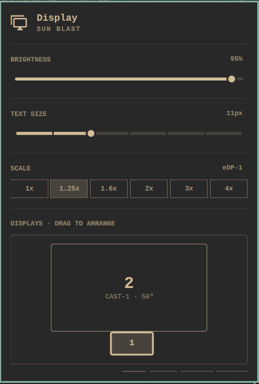

# Omarchy Display+

Omarchy Display+ adds a second display panel to the bar, next to Omarchy's own: a screen map that draws every monitor at its real physical size, where you drag screens into place and rotate them. It converts each drag from millimetres to Hyprland's logical pixels, so mixed sizes and scales line up where the screens physically meet, and the layout survives reboots. It also casts to a smart TV over Miracast: mirror a screen or add the TV as another one.



- **Screen map.** Every screen is drawn at its real size in inches. Drag one to move it, and it snaps to the edges of the others. Click a screen to select it, then rotate it from the buttons under the map.
- **Cast to TV.** Lists Miracast TVs nearby. Pick Mirror to show the screen you are on, or Extend to get a new screen on the map at the TV's size.
- Brightness, text size and scale stay in Omarchy's own Display panel, untouched.

## Install

```sh
omarchy plugin add https://github.com/georgedakoul/omarchy-display-plus --enable
```

That is all: the icon appears in the bar. Remove it with `omarchy plugin remove ghostl9.display-plus`.

## Needs

- Omarchy with Hyprland's Lua config.
- Casting: NetworkManager with a Wi-Fi card that supports Wi-Fi Direct (`iw list` shows `P2P-GO`), a GPU with VA-API H.264 encoding, `dnsmasq`, `ffmpeg` and `wf-recorder` (`sudo pacman -S wf-recorder`).

## How it works

- `tv-displays` keeps positions and rotation in `~/.config/omarchy/tv-displays.json` and writes them to `~/.local/state/omarchy/toggles/hypr/display-plus.lua`, which Omarchy loads after `hypr/monitors.lua`. Your own config files are never edited.
- `cast` finds TVs through NetworkManager, connects over Wi-Fi Direct, runs the Miracast session itself and streams with `wf-recorder`, hardware-encoded through VA-API. It sends the stream exactly as the Wi-Fi Display spec asks (the H.264 level the TV can decode, the fixed MPEG-TS PIDs), because TVs tested only against Windows show a black screen for anything else.

## Tested on

| TV | Mirror | Extend |
|---|---|---|
| Samsung UE50TU7172 (2020, Tizen) | 1080p60 with sound | 1080p60 with sound |

Sender: Intel UHD 620 laptop on Omarchy. If your TV works or does not, open an issue with its model and the line `cast: TV offers ...` from the log below, so it can go in this table.

## Troubleshooting

- **No TVs listed.** Turn the TV on and open its Screen Mirroring source. Check that `nmcli device` shows a `wifi-p2p` device.
- **Cast failed.** The panel shows the reason. The full log is in `journalctl --user -u omarchy-cast`.
- **Black screen on the TV.** Open an issue with the `cast: TV offers ...` line from that log.

## Tests

```sh
node Layout.test.js   # Layout ok
python3 cast_test.py  # cast ok
```
